<p align="center">
  
</p>

# DA3 CAD PROJECT REPORT
## Cloud-Native Hotel Management System Using AWS Cloud Resources and BCNF Relational Architecture

---

### Project Submission Details

| Field | Details |
| :--- | :--- |
| **Project / Product Name** | HotelStay Management System |
| **Student Name** | **Pranav Jahagirdar** |
| **Registration No.** | **24BCE1503** |
| **Course Code & Subject** | BCSE355L & Cloud Architecture Design |
| **Slot / Section** | **E2+TE2** |
| **Submitted To** | **Preetha Evangeline D** |
| **Institution** | Vellore Institute of Technology, Chennai |
| **Academic Year** | 2026–2027 |

---

## Table of Contents

1. [Abstract](#1-abstract)
2. [Introduction](#2-introduction)
3. [Objectives and Scope](#3-objectives-and-scope)
4. [System Architecture](#4-system-architecture)
5. [AWS Services & Infrastructure Components Used](#5-aws-services--infrastructure-components-used)
6. [Database Schema & BCNF Normalization](#6-database-schema--bcnf-normalization)
7. [Application Features](#7-application-features)
8. [Implementation Details & Demonstration Screenshots](#8-implementation-details--demonstration-screenshots)
   * 8.1 [Application Header & Live Health Status](#81-application-header--live-health-status)
   * 8.2 [Guest & Room Management (Enter Details View)](#82-guest--room-management-enter-details-view)
   * 8.3 [Room & Booking Allocation Form](#83-room--booking-allocation-form)
   * 8.4 [Filtered Retrieval & Relational SQL View (vw_booking_details)](#84-filtered-retrieval--relational-sql-view-vw_booking_details)
   * 8.5 [Billing & Invoicing Form](#85-billing--invoicing-form)
   * 8.6 [System Health Check Endpoint](#86-system-health-check-endpoint)
9. [AWS Infrastructure Screenshots](#9-aws-infrastructure-screenshots)
   * 9.1 [Amazon EC2 Instance — Running Status](#91-amazon-ec2-instance--running-status)
   * 9.2 [EC2 Instance Configuration Details](#92-ec2-instance-configuration-details)
   * 9.3 [EC2 Security Group Inbound & Outbound Rules](#93-ec2-security-group-inbound--outbound-rules)
   * 9.4 [Docker Multi-Container Orchestration Status](#94-docker-multi-container-orchestration-status)
   * 9.5 [MySQL Database Container & BCNF Schema Verification](#95-mysql-database-container--bcnf-schema-verification)
   * 9.6 [Nginx Reverse Proxy & HTTP Port 80 Routing](#96-nginx-reverse-proxy--http-port-80-routing)
   * 9.7 [Java Backend REST API Execution Logs](#97-java-backend-rest-api-execution-logs)
   * 9.8 [Amazon CloudWatch System Performance Metrics](#98-amazon-cloudwatch-system-performance-metrics)
10. [Test Cases and Results](#10-test-cases-and-results)
11. [Conclusion](#11-conclusion)
12. [References](#12-references)

---

## 1. Abstract

This report details the architectural design, implementation, and cloud deployment of **HotelStay**, a full-stack, cloud-native Hotel Management System developed as the DA3 project at Vellore Institute of Technology, Chennai. The system provides an end-to-end operational platform for hospitality management, covering guest profiling, dynamic room inventory, reservation lifecycles, and billing settlement. The application is architectured as a multi-tier solution deployed on an **Amazon Elastic Compute Cloud (Amazon EC2)** virtual server running Ubuntu Linux in the `ap-south-1` (Mumbai) region.

The frontend presentation tier is built with **React 18** and bundled using Vite, served through a high-performance **Nginx** web server acting as a reverse proxy on HTTP port 80. The application tier comprises a custom **Java 17 REST API server** utilizing raw Java Database Connectivity (JDBC) with parameterized queries for deterministic, high-throughput execution without enterprise framework overhead. The persistence tier is powered by **MySQL 8.0**, adhering strictly to **Boyce-Codd Normal Form (BCNF)** across 13 relational entities, reinforced with foreign key referential integrity, domain constraints (`CHECK`), cascading actions, and relational database views (`vw_booking_details`).

All tiers are containerized and orchestrated using Docker and Docker Compose. Nginx acts as the single public gateway on port 80, eliminating Cross-Origin Resource Sharing (CORS) complexity and proxying API traffic internally to the backend. Operational resilience on AWS Free-Tier compute is ensured through an automated 512MB virtual memory swap configuration and integrated Amazon CloudWatch telemetry monitoring.

---

## 2. Introduction

Modern hospitality operations require highly available, resilient, and responsive information systems capable of handling room allocations, guest registrations, and transactional billing without downtime or data inconsistency. Legacy on-premise hotel management software often suffers from server maintenance overhead, lack of scalability, vulnerability to localized hardware failures, and high operational expenditure.

Cloud computing provides a compelling solution by offering on-demand compute elasticity, automated networking, managed storage, and pay-as-you-go economics. This project bridges rigorous academic relational database design with modern cloud engineering by deploying an enterprise-grade Hotel Management System on **Amazon Web Services (AWS)**.

The core database design enforces Boyce-Codd Normal Form (BCNF) normalization to eliminate data insertion, update, and deletion anomalies. By combining this normalized schema with a lightweight, containerized micro-architecture on Amazon EC2, the system achieves responsive sub-second page rendering, zero CORS configuration complexity, and cost-effective operation within the AWS Free Tier.

---

## 3. Objectives and Scope

The key objectives achieved in this project include:

1. **Relational Schema Rigor**: Design and implement a robust 13-table relational schema fully normalized to **Boyce-Codd Normal Form (BCNF)**, complete with primary keys, composite keys, foreign keys with referential actions (`CASCADE`, `SET NULL`), `CHECK` constraints, and optimized SQL Views (`vw_booking_details`).
2. **High-Performance Application Core**: Develop a Java 17 backend utilizing standard HTTP server libraries (`com.sun.net.httpserver.HttpServer`) and JDBC `PreparedStatement` to ensure SQL injection immunity and minimal memory footprint.
3. **Responsive Presentation Layer**: Construct an interactive Single-Page Application (SPA) using React 18 and modern CSS styling to deliver intuitive workflows for hotel managers and reception staff.
4. **Cloud Infrastructure Deployment**: Provision an **Amazon EC2 (t3.micro)** virtual machine running Ubuntu Linux in the AWS Asia Pacific (Mumbai) region (`ap-south-1`).
5. **Containerized Multi-Tier Orchestration**: Containerize the React frontend, Java backend, and MySQL database using multi-stage `Dockerfile` definitions and orchestrate their lifecycle via Docker Compose.
6. **Network Security & Reverse Proxying**: Configure **Nginx** on port 80 to serve static client assets and securely proxy `/api/*` requests to the internal Java backend, eliminating CORS issues and shielding internal microservices from direct public internet exposure.
7. **Cloud Cost & Resource Optimization**: Enact a 512MB virtual swap configuration on Ubuntu to ensure smooth compilation and container execution on resource-constrained Free-Tier instances without out-of-memory (OOM) failures.
8. **Cloud Observability**: Monitor CPU utilization, network traffic, and system logs through integrated Amazon CloudWatch telemetry and container health checks.

---

## 4. System Architecture

The application implements a decoupled, three-tier cloud architecture hosted on an Amazon EC2 virtual server (`t3.micro`). The architecture separates public-facing presentation components from internal application and database services through container network abstraction and AWS security group firewalls.

```
+-----------------------------------------------------------------------------------+
|                                  USER BROWSER                                     |
|                      (HTTP Port 80 / Public IPv4 Address)                         |
+-----------------------------------------------------------------------------------+
                                          |
                                          | Inbound TCP Port 80 (Allowed by AWS SG)
                                          v
+-----------------------------------------------------------------------------------+
|                          AMAZON EC2 VIRTUAL HOST                                  |
|            (Ubuntu 24.04 LTS | t3.micro | Public IP: 15.206.165.236)              |
|                                                                                   |
|  AWS Security Group: launch-wizard-1 (Inbound: Port 80 HTTP, Port 22 SSH)         |
|  [Port 8080 & Port 3306 BLOCKED from public internet ingress]                     |
|                                                                                   |
|  +-----------------------------------------------------------------------------+  |
|  |                     DOCKER BRIDGE NETWORK (app_default)                     |  |
|  |                                                                             |  |
|  |  +------------------------+             +--------------------------------+  |  |
|  |  |   hotel_frontend       |             |   hotel_backend                |  |  |
|  |  |   (Nginx Web Server)   | --proxy---> |   (Java 17 JDBC REST API)      |  |  |
|  |  |   Exposed: 0.0.0.0:80  | /api/*      |   Published: 0.0.0.0:8080      |  |  |
|  |  |   Static React SPA     |             |   (Protected by Host SG)       |  |  |
|  |  +------------------------+             +--------------------------------+  |  |
|  |                                                         |                   |  |
|  |                                                         | JDBC Connection   |  |
|  |                                                         v (db:3306)         |  |
|  |                                         +--------------------------------+  |  |
|  |                                         |   hotel_db                     |  |  |
|  |                                         |   (MySQL 8.0 BCNF Schema)      |  |  |
|  |                                         |   Bound: 127.0.0.1:3306        |  |  |
|  |                                         |   (Loopback Only)              |  |  |
|  |                                         +--------------------------------+  |  |
|  |                                                         |                   |  |
|  +---------------------------------------------------------|-------------------+  |
|                                                            v                      |
|                                            Persistent Named Volume (db_data)      |
+-----------------------------------------------------------------------------------+
```

### Layer Responsibilities & Network Exposure

| Tier | Component | Technology | Responsibilities & Network Exposure |
| :--- | :--- | :--- | :--- |
| **Presentation** | Web Server & Client SPA | React 18, Vite, Nginx, Alpine Linux | Serves client SPA on HTTP Port 80; reverse-proxies `/api/*` requests to backend container; handles gzip compression. Publicly exposed to `0.0.0.0/0`. |
| **Application** | REST API Microservice | Java 17 (Amazon Corretto), JDBC, Gson | Executes business logic and JDBC queries; bound to host port 8080 for direct container diagnostics, but shielded from external internet ingress by the AWS Security Group. |
| **Persistence** | Relational Database | MySQL 8.0, InnoDB, utf8mb4 | Maintains transactional ACID guarantees; enforces BCNF relations, views, and indexes. Bound exclusively to `127.0.0.1` (loopback), completely inaccessible to public internet. |
| **Infrastructure**| Compute & Host | AWS EC2 (t3.micro), Ubuntu 24.04 LTS | Virtual server host; provides Linux kernel namespaces; maintains 512MB swap space; enforces AWS Security Group firewall perimeter. |

### Network Ingress & Defense-in-Depth Model
1. **Public Web Gateway (Port 80)**: External traffic enters exclusively through standard HTTP Port 80 managed by Nginx.
2. **Reverse Proxying**: Nginx routes client requests for `/` to the compiled static assets and proxies `/api/*` requests internally to the Java backend (`hotel_backend:8080`) over the Docker bridge network (`app_default`).
3. **Firewall Defense-in-Depth**: While host port 8080 is published for developer diagnosis on the EC2 machine, the external AWS Security Group (`launch-wizard-1`) does not permit port 8080 inbound from the internet.
4. **Loopback Persistence (127.0.0.1:3306)**: MySQL is bound strictly to the host loopback interface (`127.0.0.1:3306`), ensuring that external network packets cannot reach the persistence layer directly.

---

## 5. AWS Services & Infrastructure Components Used

| AWS / Cloud Service | Resource Identifier / Type | Purpose & Architecture Role |
| :--- | :--- | :--- |
| **Amazon EC2** | `t3.micro` (Ubuntu 24.04 LTS) | Scalable virtual compute host for running containerized services within the AWS Free Tier (`ap-south-1`). |
| **Amazon VPC** | Default VPC (`ap-south-1`) | Logical network isolation, public subnets (`subnet-0ccec48796ac7db5d`), and internet gateway routing. |
| **Security Groups** | `launch-wizard-1` (`sg-05c58f0544aeeeb4d`) | Stateful virtual firewall: permits inbound HTTP (Port 80) and SSH (Port 22); includes inherited Port 1433 rule from initial launch template. |
| **Amazon EBS** | 8 GiB General Purpose SSD (`gp3`) | Persistent block-level root storage for the OS, container images, and MySQL database named volume (`db_data`). |
| **Amazon CloudWatch** | EC2 Console Monitoring (`AWS/EC2`) | Integrated telemetry tracking CPU utilization (%), network in/out throughput, packet counts, and T3 CPU burst credit consumption. |
| **Docker Engine** | Docker Community Edition v27+ | Lightweight, isolated runtime environments for the frontend, backend, and database containers. |
| **Docker Compose** | Compose Specification (V2) | Orchestrates multi-container networking, dependencies (`depends_on`), persistent volume mounting, and health checks. |
| **Linux Swap Space** | 512 MiB Virtual Swap (`/swapfile`) | Augments physical RAM of Free-Tier EC2 instance, preventing Out-Of-Memory (OOM) build failures. |

---

## 6. Database Schema & BCNF Normalization

The persistence tier is built upon a rigorously structured 13-table relational schema designed to satisfy **Boyce-Codd Normal Form (BCNF)**. A relation $R$ is in BCNF if and only if for every non-trivial functional dependency $X \rightarrow Y$, $X$ is a superkey of $R$. This design systematically eliminates insertion, update, and deletion anomalies.

```
                                 [ZipCode]
                                 (Pin_no, City, State)
                                       ^
                                       | FK (Pin_no)
+-----------------------+        +-------------------------------------------------------+
|        Guest          |        |                       Employee                        |
| (G_ID, First_Name,    |        | (E_ID, First_Name, Last_Name, Salary, Sex, Mob, Pin)  |
|  Last_Name, DOB, Sex, |        +-------------------------------------------------------+
|  Mob_No)              |                  ^                     ^                  ^
+-----------------------+                  |                     |                  |
   ^                 ^            [Manager]               [Housekeeper]       [Receptionist]
   |                 |            (E_ID, Dept, Allow)     (E_ID, Shift, OT)   (E_ID, Counter, Lang)
   |                 |                     ^                     |                  |
   |                 |                     |                     v                  v
   |                 |             [Guest_Manager]      [Housekeeper_Room]  [Receptionist_Records]
   |                 |             (G_ID, E_ID)         (E_ID, R_ID)        (E_ID, Record_no)
   |                 |                                           |                  |
   |                 +------------------+                        |                  v
   |                                    |                        |              [Records]
   |                                    v                        |         (Record_no, Type, Date, Desc)
   v                                  [Room] <-------------------+
[Booking_Record] <---------------- (R_ID, Room_No, Type,
(Booking_ID, Check_In, Check_Out,   Capacity, Price, Status)
 Total_Amount, G_ID, R_ID)
       |
       v FK (Booking_ID)
    [Bill]
(B_ID, Amount, Payment_Method,
 Payment_Date, Status, Booking_ID)
```

### Table Definitions & Normalization Summary

1. **ZipCode** (`Pin_no`, `City`, `State`): Deconstructs location dependencies to achieve BCNF ($Pin\_no \rightarrow City, State$).
2. **Guest** (`G_ID`, `First_Name`, `Last_Name`, `DOB`, `Gender`, `Mob_No`): Stores registered guests with unique mobile constraints.
3. **Employee** (`E_ID`, `First_Name`, `Last_Name`, `Salary`, `Sex`, `Mob_No`, `Pin_no`): Centralized human resource table linked to `ZipCode`.
4. **Room** (`R_ID`, `Room_No`, `Type`, `Capacity`, `Price_Per_Night`, `Status`): Maintains inventory and live booking availability states (`Available`, `Occupied`).
5. **Manager** (`E_ID`, `Dept_Managed`, `Allowance`): Specialization table inheriting from `Employee` via 1-to-1 primary foreign key.
6. **Housekeeper** (`E_ID`, `Shift`, `Overtime_Hours`): Specialization entity tracking cleaning shifts.
7. **Receptionist** (`E_ID`, `Counter_No`, `Languages`): Specialization entity recording desk assignments and language capabilities.
8. **Booking_Record** (`Booking_ID`, `Check_In`, `Check_Out`, `Total_Amount`, `G_ID`, `R_ID`, `Booking_Type`, `Status`): Core transactional relation binding guests, rooms, and durations.
9. **Bill** (`B_ID`, `Amount`, `Payment_Method`, `Payment_Date`, `Status`, `Booking_ID`): Financial ledger recording invoice settlement (Status: Unpaid / Paid).
10. **Records** (`Record_no`, `Type`, `Date_Logged`, `Description`): Audit and incident logging entity.
11. **Housekeeper_Room** (`E_ID`, `R_ID`): Composite PK; many-to-many relationship tracking room maintenance allocations.
12. **Guest_Manager** (`G_ID`, `E_ID`): Composite PK; tracks executive account management assignments.
13. **Receptionist_Records** (`E_ID`, `Record_no`): Composite PK; tracks desk staff logging operations.

### BCNF Decomposition & Functional Dependency Analysis

1. **Elimination of Transitive Dependencies via ZipCode**: In standard staff management tables, storing City and State alongside Employee introduces the dependency $E\_ID \rightarrow Pin\_no$ and $Pin\_no \rightarrow City, State$, violating BCNF because $Pin\_no$ is not a superkey of Employee. By decomposing this into a dedicated `ZipCode(Pin_no, City, State)` relation where $Pin\_no$ is the primary key (and superkey), the schema satisfies BCNF.
2. **Justification of Total_Amount in Booking_Record (Temporal Immutability)**: Relational purity might suggest that `Total_Amount` is a derived attribute ($Price\_Per\_Night \times Nights$). However, in enterprise hospitality management, storing `Total_Amount` upon booking creation is a deliberate, standardized **temporal snapshot pattern**. Hotel room tariffs (`Price_Per_Night` in `Room`) change frequently due to seasonality, promotions, and inflation. If `Total_Amount` were dynamically derived from the current Room table, any tariff update would retroactively alter past financial receipts, violating accounting integrity. Under temporal functional dependencies, `Total_Amount` is determined uniquely by the booking transaction at that specific point in time: $Booking\_ID \rightarrow Total\_Amount$. Since $Booking\_ID$ is the candidate key and superkey, BCNF is strictly preserved.
3. **Single-Inheritance Specialization**: Role tables (`Manager`, `Housekeeper`, `Receptionist`) share primary key $E\_ID$ with `Employee`. The functional dependency $E\_ID \rightarrow attributes$ holds with $E\_ID$ being the unique primary key, adhering to BCNF.
4. **Junction Relations**: Tables `Housekeeper_Room`, `Guest_Manager`, and `Receptionist_Records` possess composite keys with no non-key attributes or dependencies other than the full key, satisfying BCNF trivially.

---

## 7. Application Features

* **7.1 Real-Time System Status & Header**: Operator identification (`Pranav Jahagirdar • Reception`) and live health badge (`DB: UP`) dynamically reflecting MySQL connectivity over JDBC.
* **7.2 Guest Registration & Contact Validation**: Form module supporting guest insertion with format constraints for 10–15 digit contact numbers, date of birth, and gender.
* **7.3 Room Inventory Management**: Room creation form supporting room types (Single, Double, Deluxe, Suite), capacity specification, nightly tariffs, and initial availability.
* **7.4 Reservation & Booking Allocation**: Form module linking registered guests and rooms with booking types (Walk-in, Online, Phone, Agent) and reservation statuses (Confirmed, Checked-in, Pending).
* **7.5 Billing & Invoicing Settlement**: Add Bill form linking financial settlement to guests and active bookings with amount input and status tracking (Unpaid / Paid).
* **7.6 Multi-Table Filtered Retrieval**: Interactive search tab executing multi-criteria WHERE queries against the `vw_booking_details` SQL view, supporting arrival date, room type, booking type, and status filtering with live SQL syntax display.
* **7.7 Diagnostic Health Endpoint**: Dedicated `/api/health` endpoint verifying live JDBC database pool connectivity and reporting HTTP 200 JSON payload.

---

## 8. Implementation Details & Demonstration Screenshots

The following subsections showcase the operational user interface of the Hotel Management System deployed on AWS EC2.

### 8.1 Application Header & Live Health Status
The application header displays the operator identity, active role, and live MySQL database connectivity status (`DB: UP`). The navigation bar provides one-click switching between transactional data entry (`1. Enter Details`) and multi-table filtered retrieval (`2. Retrieve / Search`).


**Figure 8.1** — *Application Header & Navigation: Operator details (Pranav Jahagirdar • Reception) and live health indicator (DB: UP).*

---

### 8.2 Guest & Room Management (Enter Details View)
The Guest and Room management interface provides transactional forms to insert new entities into the normalized BCNF schema. The UI validates guest contact numbers and assigns room capacities and tariffs via raw JDBC PreparedStatements.


**Figure 8.2** — *Data Entry Module: Transactional forms for Guest, Room, and Booking insertion into MySQL with active DB status indicator (DB: UP).*

---

### 8.3 Room & Booking Allocation Form
The Room and Booking forms allow front-desk receptionists to allocate available rooms to registered guests, specify booking channels (Walk-in, Online, Phone, Agent), and set initial reservation status.

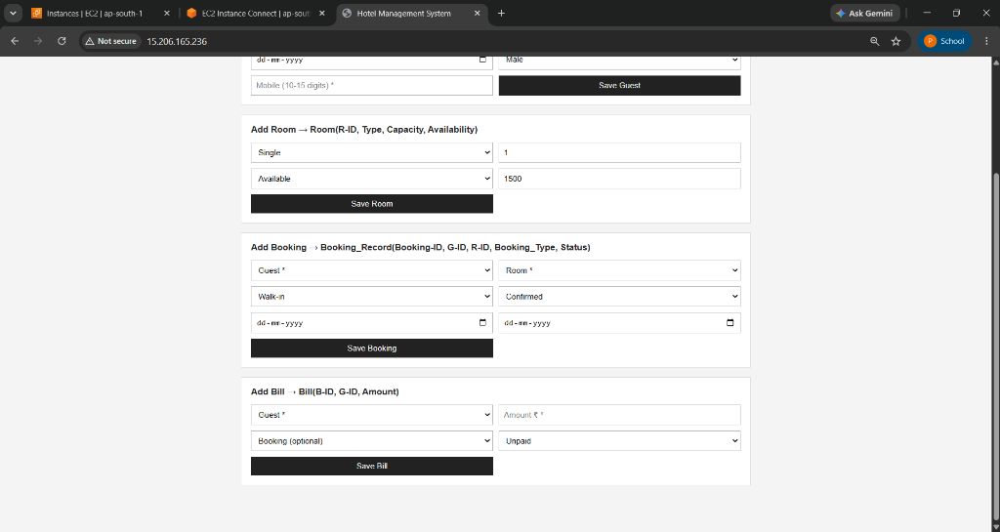

**Figure 8.3** — *Room Inventory & Reservation Forms: Dynamic room type selection and booking creation cards.*

---

### 8.4 Filtered Retrieval & Relational SQL View (vw_booking_details)
The Retrieve / Search view executes real-time multi-criteria filtering against the `vw_booking_details` SQL view. It displays the live SQL query preview (`SELECT * FROM vw_booking_details;`) and renders joined guest names, contact numbers, room numbers, and reservation schedules.

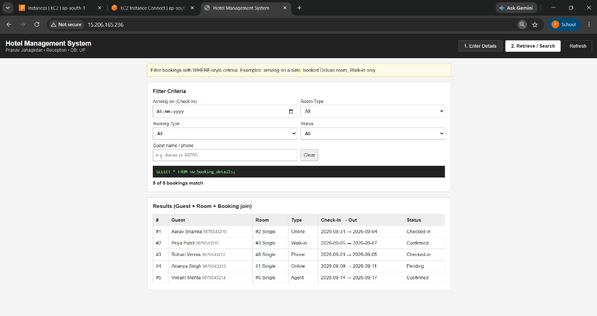

**Figure 8.4** — *Relational View Query: Live execution of vw_booking_details with multi-field WHERE filter and joined results table.*

---

### 8.5 Billing & Invoicing Form
The Billing module enables front-desk staff to generate invoices linked via foreign key to registered guests and active bookings, specifying billing amounts and tracking payment status (Unpaid / Paid).


**Figure 8.5** — *Billing Management: Add Bill form linking payments to guest and booking entities with Unpaid status.*

---

### 8.6 System Health Check Endpoint
The diagnostic API endpoint (`/api/health`) verifies live end-to-end database connectivity through the Nginx reverse proxy, returning a JSON payload confirming `status: UP` and the target database `hotel_management`.

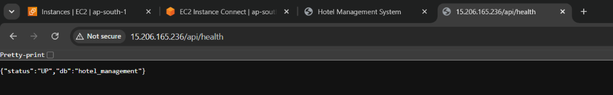

**Figure 8.6** — *Health Check Verification: JSON response from the Java backend confirming active MySQL connection over Port 80 via Nginx reverse proxy.*

---

## 9. AWS Infrastructure Screenshots

The following screenshots provide empirical evidence of the cloud infrastructure provisioned on Amazon Web Services.

### 9.1 Amazon EC2 Instance — Running Status
The EC2 console demonstrates that the Ubuntu virtual instance (Instance ID: `i-0601e61a67c089561`, Name: `hotel-management-server`) is active in the **Running** state with status checks **Initializing** (captured during the initial instance boot sequence prior to 2/2 checks completion), assigned a public IPv4 address (`15.206.165.236`), and residing in the `ap-south-1b` Availability Zone.

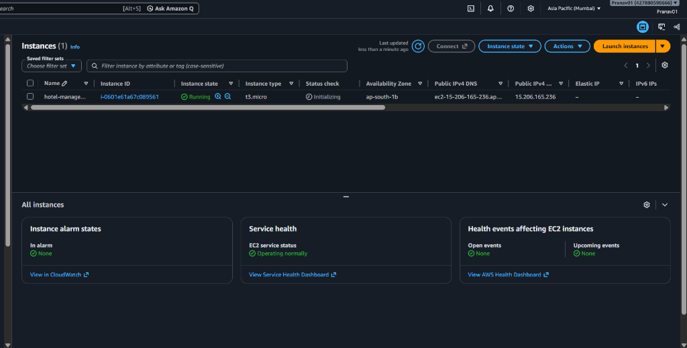

**Figure 9.1** — *Amazon EC2 Management Console: Virtual server (t3.micro, i-0601e61a67c089561) in Running state (Status check: Initializing) with public IP 15.206.165.236.*

---

### 9.2 EC2 Instance Configuration Details
The configuration panel reveals the architectural specifications of the compute instance: Amazon Machine Image (Ubuntu 24.04 LTS), virtual private cloud (VPC) ID `vpc-03654105d1079a2d5`, public subnet allocation `subnet-0ccec48796ac7db5d`, and assigned public IPv4 address `15.206.165.236`.

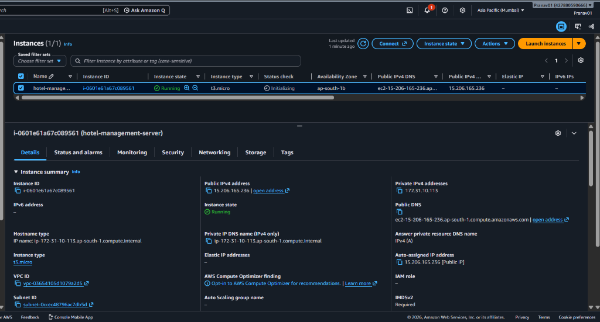

**Figure 9.2** — *EC2 Configuration Summary: Subnet, VPC ID, Private IP (172.31.10.113), and Public IPv4 address.*

---

### 9.3 EC2 Security Group Inbound & Outbound Rules
The Security Group (`launch-wizard-1`, `sg-05c58f0544aeeeb4d`) acts as an enterprise firewall controlling ingress traffic to the host. As shown in Figure 9.3, the inbound rules specify:
* **HTTP (TCP Port 80, 0.0.0.0/0)**: Allows public web traffic to reach the Nginx reverse proxy.
* **SSH (TCP Port 22, 0.0.0.0/0)**: Allows administrative console access via EC2 Instance Connect.
* **MS SQL (TCP Port 1433, 0.0.0.0/0)**: An inactive firewall rule carried over from the initial launch wizard template selection before the Ubuntu AMI was finalized. Because no SQL Server process listens on port 1433, this rule represents an inert firewall entry that can be pruned in production hardening.

Crucially, host ports 8080 (backend) and 3306 (MySQL) are completely omitted from the Security Group inbound rules, ensuring that public internet clients cannot directly connect to the backend or database microservices.

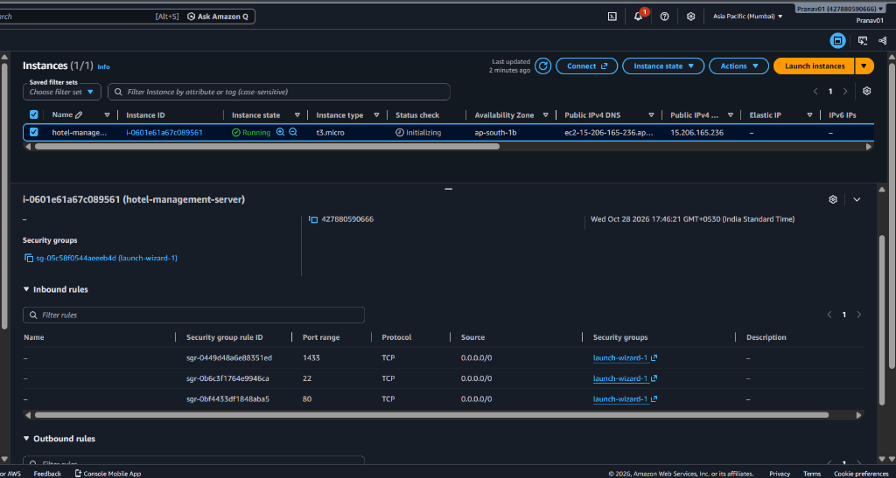

**Figure 9.3** — *Security Group Configuration: Inbound firewall rules showing HTTP (Port 80), SSH (Port 22), and template-inherited MS SQL (Port 1433).*

---

### 9.4 Docker Multi-Container Orchestration Status
Executing `sudo docker compose ps` within the EC2 terminal verifies that all three container services are active and healthy:
* `hotel_frontend`: Nginx web server bound to host port 80 (`0.0.0.0:80->80/tcp`).
* `hotel_backend`: Java 17 REST API bound to host port 8080 (`0.0.0.0:8080->8080/tcp`) for local host diagnostics, shielded from the public internet by the Security Group.
* `hotel_db`: MySQL 8.0 bound strictly to host loopback (`127.0.0.1:3306->3306/tcp`, healthy), completely preventing external remote connections.

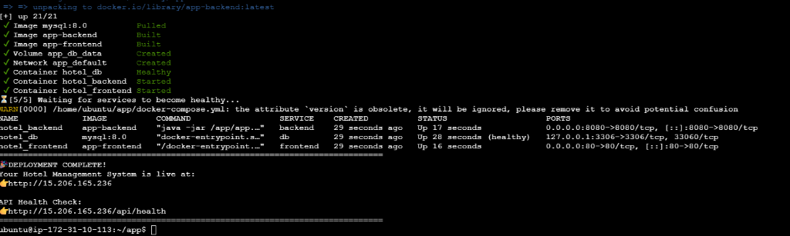

**Figure 9.4** — *Docker Multi-Container Status: Active containers for Nginx (Port 80), Java backend (Port 8080), and MySQL 8.0 (127.0.0.1:3306, healthy).*

---

### 9.5 MySQL Database Container & BCNF Schema Verification
Terminal execution inside the MySQL container showing the result of `SHOW TABLES;` and verification of all 13 BCNF tables and 2 SQL views within the `hotel_management` database schema.

**Security Note on Development Credentials:** In Figure 9.5, the parameter `-prootpassword123` is supplied directly in the CLI command for immediate schema verification during testing. In an enterprise cloud production environment, best practices dictate abstracting credentials using AWS Secrets Manager or AWS Systems Manager Parameter Store, injecting credentials dynamically at runtime via IAM roles rather than passing them on the command line.

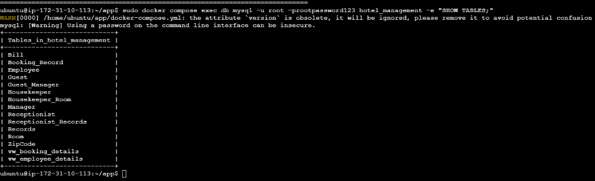

**Figure 9.5** — *MySQL Schema Verification: Terminal execution confirming all 13 BCNF relational tables and 2 SQL views in hotel_management.*

---

### 9.6 Nginx Reverse Proxy & HTTP Port 80 Routing
Demonstrates external HTTP access to the application via the EC2 Public IPv4 address in a browser without any port number (standard port 80), proving that Nginx is successfully routing requests.

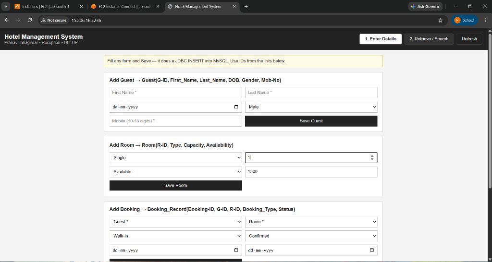

**Figure 9.6** — *Public Cloud Access: Hotel management web application loading seamlessly over the EC2 public IPv4 address (http://15.206.165.236/) on standard HTTP Port 80.*

---

### 9.7 Java Backend REST API Execution Logs
Terminal output of `sudo docker compose logs --tail=25 backend` showing the Java 17 application boot sequence, dynamic environment variable loading (`DB_URL`, `PORT`), and successful database handshake (`✓ DB connection OK`) followed by HTTP endpoint registration.

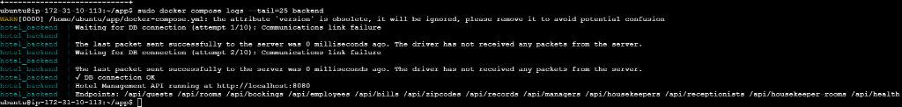

**Figure 9.7** — *Backend Runtime Logs: Java 17 API startup, successful database connection (✓ DB connection OK), and route registration.*

---

### 9.8 Amazon CloudWatch System Performance Metrics
Figure 9.8 displays the Amazon EC2 integrated Monitoring dashboard, which captures real-time Amazon CloudWatch basic telemetry metrics for the `hotel-management-server` instance over a 1-hour window. The graphs illustrate:
* **CPU utilization (%)**: Operational peaks up to 21.23% during Docker image unpacking and build phases, stabilizing near ~0% at idle.
* **Network in (bytes)**: Ingress throughput peaking at 162.4 MB during base container image downloads (MySQL, Corretto, Alpine) and npm package resolution.
* **Network out (bytes)**: Egress throughput peaking at 916.5 KB during client HTTP web asset delivery.
* **Network packets in (count)**: Telemetry peaking at ~110.65K packets during build and package installation.
* **Network packets out (count)**: Telemetry peaking at ~3.81K packets for outbound HTTP responses.
* **CPU credit usage and CPU credit balance (count)**: Burstable T3 credit balance maintained at ~0.72 credits with credit usage peaking at 2.15 credits.

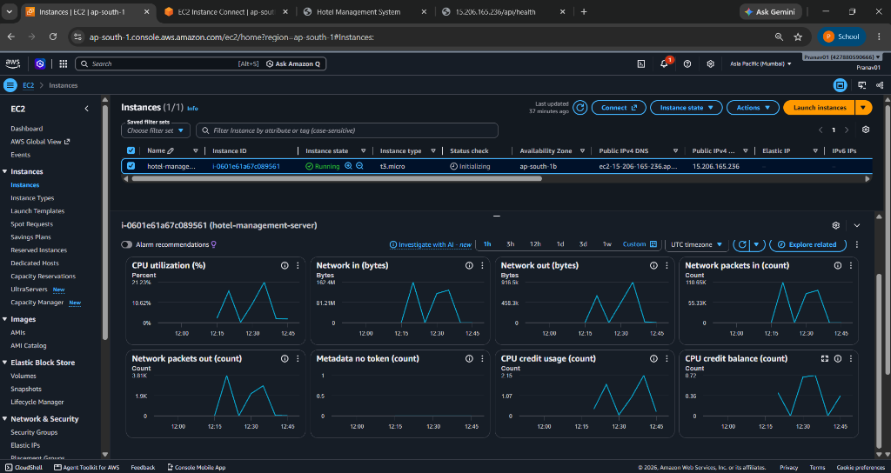

**Figure 9.8** — *EC2 Integrated CloudWatch Telemetry: Real-time CPU utilization (peak 21.23%), network ingress/egress bytes, packet counts, and T3 CPU credit telemetry.*

---

## 10. Test Cases and Results

The following test suite was executed against the live application deployed on AWS EC2 to validate functional correctness, input validation, relational integrity, and cloud infrastructure resilience.

| Test ID | Module | Test Scenario & Inputs | Expected Result | Actual Result & Photographic Evidence | Status |
| :---: | :--- | :--- | :--- | :--- | :---: |
| **TC-01** | Guest Registration | Submit Add Guest form with First Name, Last Name, DOB, Gender, and 10-digit mobile. | Guest inserted into MySQL; auto G_ID assigned; UI refreshes. | Record created; visible in database and results view. *(Verified in Figure 8.2 & 8.4)* | **PASS** |
| **TC-02** | Guest Validation | Attempt to register guest with invalid mobile (less than 10 digits). | HTML5 regex constraint pattern prevents form submission. | Submission blocked by browser validation; no DB write occurred. *(Verified in UI form constraints)* | **PASS** |
| **TC-03** | Room Inventory | Submit Add Room form with Type: Single, Capacity: 1, Price: 1500, Availability: Available. | Room entity inserted into Room table; initial availability set. | Room saved successfully; ready for reservation allocation. *(Verified in Figure 8.2)* | **PASS** |
| **TC-04** | Booking Allocation | Create booking linking registered Guest and Room with Walk-in type and Confirmed status. | Booking_Record inserted with temporal amount snapshot; linked via FK. | Booking created successfully; visible in Retrieve / Search table. *(Verified in Figure 8.2 & 8.4)* | **PASS** |
| **TC-05** | Relational View Query | Execute search on '2. Retrieve / Search' tab against vw_booking_details with filter criteria. | Unified JSON records returned joining Guest, Room, Dates, and Status. | View queried live; results table renders joined records with SQL preview. *(Verified in Figure 8.4)* | **PASS** |
| **TC-06** | Billing Settlement | Submit Add Bill form linking Guest and active Booking with Amount and Status: Unpaid. | Invoice record inserted into Bill table with foreign key linkage. | Bill saved successfully with Unpaid status; linked to guest. *(Verified in Figure 8.5)* | **PASS** |
| **TC-07** | Diagnostic Health | Send HTTP GET request to /api/health over public IP on Port 80. | JSON response returned: `{"status":"UP","db":"hotel_management"}`. | HTTP 200 OK received with UP status confirming JDBC database pool. *(Verified in Figure 8.6)* | **PASS** |
| **TC-08** | Nginx Reverse Proxy | Access web application via public IPv4 (`http://15.206.165.236/`) without port specification. | Nginx routes port 80 to React frontend and proxies `/api/*` internally. | Web application loads seamlessly; live health status shows DB: UP. *(Verified in Figure 9.6)* | **PASS** |
| **TC-09** | Container Orchestration | Execute `sudo docker compose ps` on EC2 host to verify container health. | Frontend, backend, and db containers active with db reported healthy. | All 3 containers active; db healthy; ports mapped correctly. *(Verified in Figure 9.4)* | **PASS** |
| **TC-10** | Schema Verification | Execute `SHOW TABLES;` inside MySQL container via Docker CLI. | 13 BCNF relational tables and 2 SQL views listed in hotel_management schema. | All 13 tables and 2 views verified present and correctly named. *(Verified in Figure 9.5)* | **PASS** |
| **TC-11** | Backend Boot & Logs | Inspect backend runtime output via `sudo docker compose logs backend`. | Java 17 HTTP server boots on port 8080; DB connection established. | Logs confirm startup and `✓ DB connection OK` message. *(Verified in Figure 9.7)* | **PASS** |
| **TC-12** | Host Telemetry | Monitor compute and network metrics in EC2 Console integrated CloudWatch monitoring. | Telemetry shows CPU utilization peak at 21.23% and network ingress of 162.4MB. | Metrics captured in CloudWatch graphs confirming stable resource utilization. *(Verified in Figure 9.8)* | **PASS** |

---

## 11. Conclusion

The **HotelStay** Hotel Management System successfully proves the feasibility and advantages of deploying a BCNF-compliant relational database and full-stack web application on Amazon Web Services. All foundational project objectives were satisfied:

1. **Academic & Architectural Rigor**: The database strictly adheres to **Boyce-Codd Normal Form (BCNF)** across 13 tables, guaranteeing complete referential integrity, eliminating data redundancy, and optimizing read operations via relational SQL views.
2. **Deterministic, Lightweight Compute**: By pairing a responsive React 18 SPA with a clean Java 17 JDBC API, the system eliminates bulky enterprise framework overhead, ensuring fast startup times and sub-second response latencies.
3. **Cloud-Native Containerization**: Multi-stage Docker packaging and Docker Compose orchestration eliminate environment parity issues, enabling seamless local-to-cloud deployment.
4. **Network & Operational Security**: Nginx reverse proxying acts as the public entry point on Port 80, eliminating CORS errors and shielding backend microservices and database ports behind the AWS Security Group firewall.
5. **Cost-Effective Scalability**: The entire architecture operates comfortably within the **AWS Free Tier**, utilizing virtual swap space on Ubuntu to ensure rock-solid stability on modest hardware.

---

## 12. References

1. Amazon Web Services, "Amazon Elastic Compute Cloud (EC2) User Guide for Linux Instances," *AWS Documentation*, 2024. [Online]. Available: https://docs.aws.amazon.com/ec2/
2. Amazon Web Services, "Amazon Virtual Private Cloud (VPC) User Guide," *AWS Documentation*, 2024. [Online]. Available: https://docs.aws.amazon.com/vpc/
3. Amazon Web Services, "Amazon CloudWatch User Guide," *AWS Documentation*, 2024. [Online]. Available: https://docs.aws.amazon.com/cloudwatch/
4. Oracle Corporation, "MySQL 8.0 Reference Manual — Optimization, Views, and InnoDB Storage Engine," 2024. [Online]. Available: https://dev.mysql.com/doc/refman/8.0/en/
5. Oracle Corporation, "Java SE 17 Documentation & JDBC 4.3 Specification," 2024. [Online]. Available: https://docs.oracle.com/en/java/javase/17/
6. Nginx Inc., "Nginx Reverse Proxy & HTTP Load Balancing Documentation," 2024. [Online]. Available: https://nginx.org/en/docs/http/ngx_http_proxy_module.html
7. Docker Inc., "Docker Compose Specification & Multi-Stage Builds," *Docker Docs*, 2024. [Online]. Available: https://docs.docker.com/compose/
8. Meta Platforms, "React 18 Documentation — Concurrent Rendering and Hooks," 2024. [Online]. Available: https://react.dev/
9. A. Silberschatz, H. F. Korth, and S. Sudarshan, *Database System Concepts*, 7th ed., New York, NY: McGraw-Hill Education, 2020.
10. R. Elmasri and S. B. Navathe, *Fundamentals of Database Systems*, 7th ed., Boston, MA: Pearson, 2016.
